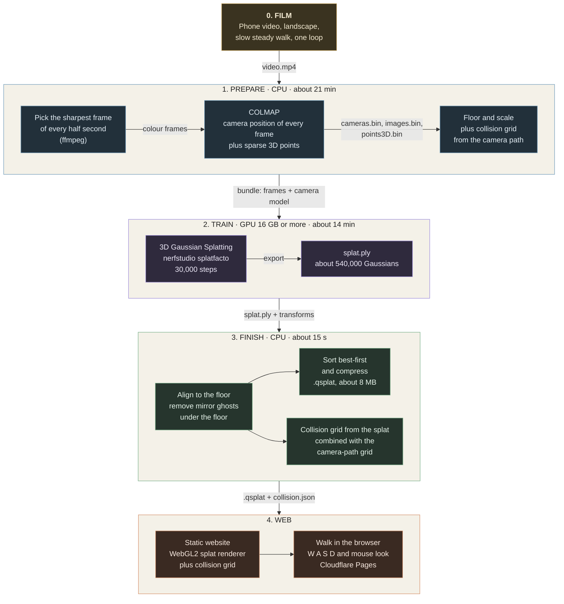
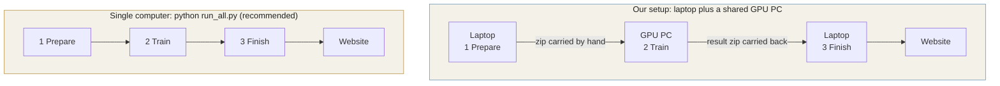

# NammaSpace

Walk through a real room in your browser, built from one phone video.

NammaSpace turns a walkthrough video into a 3D Gaussian splat and publishes it as a web page where you move with W A S D. Walls and furniture block you, so you can judge a space before you visit it. Built for IIT Techfest 2026.

## Live demo

**https://namma-space.pages.dev/**

| Page | What it is |
|---|---|
| [`/`](https://namma-space.pages.dev/) | project overview, evidence table and the three scenes |
| [`/room/`](https://namma-space.pages.dev/room/) | Room, the best scene (held-out PSNR 27.14 dB, SSIM 0.913) |
| [`/hallway/`](https://namma-space.pages.dev/hallway/) | Hallway and Bedroom, longer capture (26.46 dB) |
| [`/bedroom/`](https://namma-space.pages.dev/bedroom/) | Early Bedroom, our first capture, kept for comparison |

Click the scene, then use **W A S D** to walk, **Shift** to run, **Space** to jump, the mouse to look, **Esc** to free the mouse, **R** to return to the door, **M** for the collision grid and **N** for the live map. Add `?debug` to the address for a performance panel.

## How it works

One phone video goes in, a walkable 3D scene comes out. Every arrow is labelled with the file that moves along it.



### The same three stages on one machine or two

The stages never change. Only where they run, and whether you carry a zip by hand, changes.



| | Single computer | Our two-machine setup |
|---|---|---|
| Command | `python run_all.py --video my.mp4` | `STEP1_prepare_video.bat`, then `RUN_NEW_BUNDLE.sh` on the GPU PC, then `STEP3_finish_and_open_website.bat` |
| Needs | one NVIDIA GPU of 16 GB or more | a laptop for stages 1 and 3 and a GPU PC for stage 2 |
| Hand-off | none | a zip carried each way |
| Why we used it | | the laptop GPU has 6 GB, and the lab GPU PC is shared |

## Three ways to use this repository

| I want to | Do this |
|---|---|
| **Just look at the result** | Open the live demo above. Nothing to install. |
| **Run a scene on my own computer** | `cd 01_room/site` then `python -m http.server 8766` and open http://localhost:8766/. On Windows, double-click `START_WINDOWS.bat` in that folder. |
| **Rebuild a scene with the pipeline** | Follow "Rebuild on one computer" below. |

## Rebuild on one computer

A single script, `run_all.py`, runs the whole pipeline: video, camera positions, training, website.

### 1. Requirements

| Need | Detail |
|---|---|
| OS | Linux, or Windows with WSL2. Training is only proven on Linux. |
| GPU | NVIDIA with 16 GB of GPU memory or more (we measured 14 to 16 GB at full 1080p) and a CUDA 12.x driver |
| Disk | 20 GB free |
| Tools on PATH | `ffmpeg` and `ffprobe`, COLMAP 3.9 or newer, `ns-train` and `ns-export` from nerfstudio |
| Python 3 packages | `pip install -r requirements.txt`, and for training `pip install -r requirements-train.txt` after installing PyTorch for your CUDA version |

Exact versions, measured GPU memory and the reasons are in [`docs/HARDWARE_AND_REMOTE_SETUP.md`](docs/HARDWARE_AND_REMOTE_SETUP.md).

### 2. Check the machine

```bash
python run_all.py --check
```

Lists each requirement as `ok` or `MISSING` with the fix, and does no work.

### 3. Try the test sample

```bash
python run_all.py --test
```

Uses the bundled sample in `test/sample_scene.zip` (40 frames, camera model and collision map already solved), trains for 1,000 steps instead of 30,000 and builds the website at http://localhost:8765/. It proves the chain works on your machine in minutes. The sample splat is rough on purpose.

### 4. Run your own video

```bash
python run_all.py --video my_walkthrough.mp4
```

| Stage | What happens | Time on Room (613 frames) |
|---|---|---|
| 1. Prepare | sharp-frame picker, COLMAP camera poses, floor and scale, collision map | about 21 min (mostly COLMAP) |
| 2. Train | 3D Gaussian splat with nerfstudio splatfacto, 30,000 steps | about 14 min on a large GPU |
| 3. Finish | align, clean, compress to `.qsplat`, build the website and serve it | about 15 s |

Options (training steps, profile, memory-saving flags, building from an existing result without a GPU) are listed in [`docs/RUN_GUIDE.md`](docs/RUN_GUIDE.md), together with how to film a good capture.

### If you have a laptop and a separate GPU PC

The two-machine route we used ourselves is described in [`docs/RUN_GUIDE.md`](docs/RUN_GUIDE.md) under "Option B". [`docs/HARDWARE_AND_REMOTE_SETUP.md`](docs/HARDWARE_AND_REMOTE_SETUP.md) explains why we split it and what that costs.

### What is tested and what is not

- STEP 1 and STEP 3 have run many times on Windows. The `run_all.py` requirement check and the STEP 3 build were run on the bundled sample.
- STEP 2 (training) is proven in our two-machine setup on Linux. The one-machine `--test` run, which calls the same training script, has not yet been run on a separate clean GPU machine.
- Native Windows training was not tried.

## Results

| Scene | Folder | Frames | Gaussians | PSNR | SSIM | LPIPS |
|---|---|---:|---:|---:|---:|---:|
| Room | [`01_room`](01_room) | 613 | 541,337 | 27.14 dB | 0.913 | 0.191 |
| Hallway and Bedroom | [`02_hallway_bedroom`](02_hallway_bedroom) | 868 | 650,654 | 26.46 dB | 0.874 | 0.244 |
| Early Bedroom | [`03_bedroom_early`](03_bedroom_early) | n/a | 700,000 shown | not evaluated | | |

Scores are measured on frames held out from training. Settings and timings: [`01_room/notes/TRAINING_REPORT.md`](01_room/notes/TRAINING_REPORT.md). Each `site/` folder is a complete static website.

## Known limits

- Ceilings and areas the camera barely saw are rough or dark.
- Collision is a 2D floor grid. It stops you at walls and furniture but does not model stairs or overhangs.
- Scale assumes a fixed phone height, not a measured reference.
- Points of interest and A* route finding are not built yet.

## Repository layout

```
run_all.py             one command for the whole pipeline
requirements.txt       Python packages for STEPs 1 and 3
requirements-train.txt Python packages for STEP 2 (training)
test/                  sample scene for run_all.py --test
01_room/               hero scene: site/ and training notes
02_hallway_bedroom/    second scene, site/
03_bedroom_early/      first scene, site/
home/                  the project overview page
deploy/                publishes all scenes as one Cloudflare Pages site
namma_pipeline/
  scripts/             pipeline code (frames, COLMAP, collision, splat cleanup, compression)
  remote/              training scripts for a GPU machine
  viewer_template/     the web viewer every scene is built from
docs/                  run guide, hardware, internals
```

One video makes one scene and one website. Scenes are never mixed.

## What is not in git

Videos, frames, zips, COLMAP databases and `namma_pipeline/runs/` are ignored because they are large.
